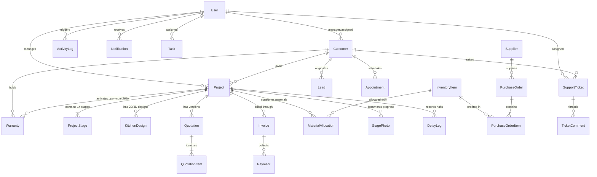
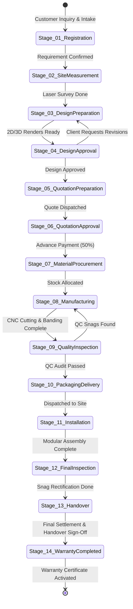

# CKTracker — Architecture & Database Design Specifications

## 1. System Overview

CKTracker is engineered as a high-performance **modular monolithic backend** paired with a responsive **React/Vite single-page application (SPA)**. It avoids microservice overhead while preserving strict separation of concerns, transactional integrity, and strong domain boundaries.

```mermaid
graph TD
    subgraph Client [Client Tier (React 18 SPA)]
        UI_Admin[Admin Dashboard & Controls]
        UI_Manager[Manager CRM & Project Kanban]
        UI_Customer[Customer Self-Service Portal]
        State[Auth & Socket Contexts]
    end

    subgraph API [API Gateway & Application Tier (Express.js)]
        MW_Auth[JWT & RBAC Middleware]
        MW_Tenant[Tenant Isolation Guard]
        MW_Val[Joi Input Validators]
        
        subgraph Modules [Domain Service Modules]
            M_Auth[Auth & User Management]
            M_CRM[CRM, Leads & Appointments]
            M_Project[14-Stage Project Engine]
            M_Design[2D/3D Design Management]
            M_Quote[Quotation & PDFKit Engine]
            M_Pay[Payments & Financials]
            M_Inv[Inventory & Supplier POs]
            M_Emp[Staff & Task Allocation]
            M_Rep[Analytics & BI Reports]
            M_Sup[Support & 10-Yr Warranty]
        end
        
        Adapters[Socket.IO / Nodemailer / WhatsApp Adapters]
    end

    subgraph Data [Data Tier]
        ORM[Prisma ORM Client]
        PG[(PostgreSQL Database - 26 Normalized Models)]
    end

    Client -->|HTTPS / REST API| MW_Auth
    Client -->|WSS / Socket.IO| Adapters
    MW_Auth --> MW_Tenant
    MW_Tenant --> MW_Val
    MW_Val --> Modules
    Modules --> ORM
    ORM --> PG
```

---

## 2. Relational Database Schema (26 Normalized Models)

CKTracker uses PostgreSQL with Prisma ORM. Below is the Entity-Relationship (ER) model organized into logical domain groupings.



### Table Specifications:

1. **User**: Authentication, RBAC (`ADMIN`, `MANAGER`, `DESIGNER`, `CUSTOMER`), active status, hashed passwords.
2. **Customer**: Full profile, phone, address, property type, estimated budget, kitchen style, dimensions.
3. **Lead**: CRM sales pipeline (`NEW`, `CONTACTED`, `INTERESTED`, `SITE_VISIT_SCHEDULED`, `QUOTATION_SENT`, `CONVERTED`, `LOST`).
4. **Appointment**: Technical site measurement surveys and design consultations.
5. **Project**: Master kitchen contract (`code`, `title`, `kitchenType`, `budget`, `currentStageNumber`, `overallStatus`).
6. **ProjectStage**: Sequential 14-stage workflow with status (`PENDING`, `IN_PROGRESS`, `COMPLETED`, `ON_HOLD`, `DELAYED`), duration, start/end dates.
7. **StagePhoto**: Workmanship and QC inspection photographs uploaded per stage.
8. **DelayLog**: Reason and duration logs for any halted stage.
9. **KitchenDesign**: 2D floor plans, elevation CADs, 3D photorealistic renders, client approval state.
10. **DesignComment**: Customer revision feedback and change requests.
11. **Quotation**: Multi-version estimation document with subtotal, discount, GST (18%), grand total, terms, and freeze flag (`isFrozen`).
12. **QuotationItem**: Granular bill of materials (carcass, shutters, Blum hinges, quartz countertops, baskets).
13. **Invoice**: Formal tax invoice linked to project and approved quotation.
14. **Payment**: Milestone receipts (`RCPT-2026-XXX`), payment mode (NEFT/RTGS/UPI/Card), balance tracking.
15. **InventoryItem**: Raw material catalog (Marine Ply 18mm, Acrylic sheets, Soft-close hinges, Tandem boxes).
16. **MaterialAllocation**: Stock deducted and reserved for a specific kitchen project.
17. **Supplier**: Vendor address, contact details, payment terms.
18. **PurchaseOrder**: Procurement orders generated to restock materials.
19. **PurchaseOrderItem**: Quantities and unit costs per supplier order.
20. **Task**: Internal staff work assignments with deadlines and priority.
21. **SupportTicket**: Post-handover customer issues and snags.
22. **TicketComment**: Two-way customer and support agent communication log.
23. **Warranty**: Official 10-year hardware and 5-year woodwork warranty certificate.
24. **ActivityLog**: Immutable audit trail of state transitions, payment recordings, and stage approvals.
25. **Notification**: Real-time bell alerts delivered via Socket.IO.
26. **Setting**: Global business configuration (company name, GSTIN, default terms).

---

## 3. Strict 14-Stage Lifecycle State Machine



### Business Logic Guardrails:
- **No Skipping**: Stage $N$ cannot enter `COMPLETED` unless Stage $N-1$ is already `COMPLETED`.
- **Mandatory Delay Reason**: If any stage is set to `DELAYED`, a descriptive reason must be logged in `DelayLog`.
- **Automatic Milestone Completion**: When Stage 14 is marked `COMPLETED`, the project's overall status automatically transitions to `COMPLETED`, setting `actualCompletionDate`.

---

## 4. Security & Role-Based Access Control (RBAC)

| Resource / Action | ADMIN | MANAGER | DESIGNER | CUSTOMER |
| :--- | :---: | :---: | :---: | :---: |
| **View All Projects** | Yes | Assigned Only | Assigned Only | Own Project Only |
| **Progress Stage** | Yes | Permitted (Stages 1–13) | No | No |
| **Upload Designs** | Yes | Yes | Yes | No |
| **Approve / Reject Designs** | Yes | No | No | Own Project Only |
| **Create / Revise Quotations** | Yes | Draft Only | No | No |
| **Approve / Reject Quotations** | Yes | No | No | Own Project Only |
| **Record Payments** | Yes | No | No | No |
| **Download PDF Invoices/Receipts** | Yes | Yes | No | Own Records Only |
| **Manage Inventory & Suppliers** | Yes | View Only | View Only | No Access |
| **Manage Staff & Roles** | Yes | No Access | No Access | No Access |
| **View Business Analytics & Revenue** | Yes | No Access | No Access | No Access |
| **Raise Support Tickets** | Yes | Yes | No | Own Project Only |
| **Activate Warranty** | Yes | No | No | View Certificate |

---

## 5. Enterprise PDF Generation Engine

PDFKit is used to generate vector-rendered, printer-ready documents without browser dependencies:
- **Quotation PDF (`backend/src/services/pdf.service.js`)**:
  - Modular kitchen branding and company GST details.
  - Client project scope and property address.
  - Structured itemized table with Category, Description, Qty, Unit Price, and Net Total.
  - Subtotal, 18% GST calculation, Trade Discount, and Grand Total formatted in Indian Currency notation (`₹`).
  - Standard payment terms (50% Advance, 40% Pre-Dispatch, 10% Post-Installation).
  - Digital authorization stamp and signature blocks.
- **Payment Receipt PDF**:
  - Formal receipt number (`RCPT-2026-XXX`).
  - Payment mode (NEFT, UPI, Card), transaction reference, and timestamp.
  - Running invoice balance indicating total paid and balance pending.
